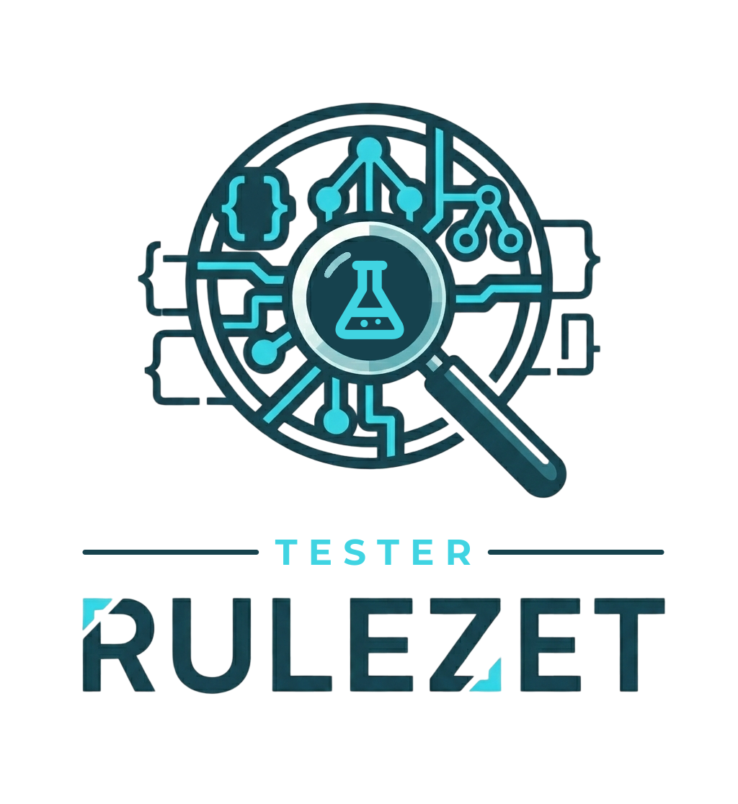

<p align="center">
  
</p>

# rulezet-tester

Run detection rules on **sample sets**, in a **sandbox**, and see for each sample whether the rule
fired: detections, misses, **false positives**, timeouts.

One pipeline for every rule format; only a small *driver* changes per format (YARA today;
Suricata, Sigma, Zeek… next). Used by:

- [rulezet-editor](https://github.com/rulezet/rulezet-editor): the **Test** panel, live while you
  write a rule;
- [Rulezet](https://github.com/ngsoti/rulezet-core): the Lab (rule pages, bundles, scores);
- anything else: the CLI (CI pipelines), the HTTP API, or the Python API.

> Status: 0.1.0 — YARA driver, bubblewrap sandbox, folder sample store, CLI, HTTP API.
> Design and security: [docs/design.md](docs/design.md).

## Quick start

```bash
sudo apt install bubblewrap            # the sandbox
pip install -e ".[yara,web]"           # from a clone

rulezet-tester sets
rulezet-tester run my_rules.yar --set benign-text --set synthetic-yara
```

```
match           synthetic-yara/PE header (MZ + DOS stub)  $mz
FALSE POSITIVE  benign-text/gnu_agpl_license.txt          $lic
clean           benign-text/backup.sh
{"total": 9, "done": 9, "detected": 0, "missed": 0, "false_positives": 1, ...}
```

`run` exits with **1** when a sample gives a false positive or a miss, **2** when the run cannot
start: drop it in a CI job.

Your own samples: `--samples /srv/samples` (repeatable), one folder per set (see below).

## Python

```python
from rulezet_tester import FolderSampleStore, Sandbox, TestService

service = TestService(FolderSampleStore('/srv/samples'), Sandbox())      # bwrap by default
run = service.start('yara', rules_text, ['benign-linux', 'emotet-2025'], owner=user_id)
service.state(run['id'], owner=user_id)      # poll: each sample turns from pending to a verdict
```

## HTTP

```python
from rulezet_tester.web import create_blueprint
app.register_blueprint(create_blueprint(service, owner=lambda: current_user.id), url_prefix='/test')
```

| | |
|---|---|
| `GET /test/sets?format=yara` | `{ available, sets }` |
| `POST /test/` `{ format, text, sets }` | `202` run, every sample `pending` |
| `GET /test/<run id>` | the run; poll until `status` is `done` or `failed` |

Standalone: `rulezet-tester serve` (http://127.0.0.1:5175/test/).

## Sample sets

```
/srv/samples/
  benign-linux/
    set.json        { "name": "Benign — Linux binaries", "format": "yara", "kind": "benign",
                      "labels": {}, "tlp": "clear", "source": "debian 13" }
    samples.json    optional: [{ "file": "...", "label": "...", "expected": "match" | "no_match" }]
    <files>
```

`kind`: `benign` (must not match → false positives), `malicious` (should match → detections and
misses), `synthetic` (crafted files, no expected result unless `samples.json` says so).

### Shipped sets (safe, in `samples/`)

| Set | Content |
|---|---|
| `synthetic-pe` | real, parseable PE32 files whose only code is `ret`: minimal, injection imports, UPX look-alike, downloader, ransom-note strings, embedded MZ |
| `synthetic-scripts` | encoded PowerShell, download cradle, `eval(atob())`, PHP `eval(base64_decode())`, AutoOpen macro, `curl \| sh`, LOLBins, and one clean admin script |
| `synthetic-documents` | PDF with OpenAction JavaScript, clean PDF, HTML smuggling page |
| `synthetic-yara` | tiny files: MZ header, UTF-16 string, URL, base64 |
| `benign-text` | licence, config, README, shell script |
| `benign-usr-bin` | the programs in `/usr/bin` of the machine running the tests, scanned in place (no copy) |
| `benign-documents-system` | PDF, Office (doc / xls / docx…), OpenDocument and RTF files under `/usr/share`, recognised from their bytes, scanned in place |
| `benign-pe-system` | every Windows PE under `/usr` (UEFI loaders, Wine / Mono libraries…), scanned in place — few on a plain Linux server: add a real Windows goodware set (below) |

Synthetic files are generated by `scripts/make_synthetic.py` (read it: everything they contain is
there). They are inert: payloads only print "rulezet test", hosts are `.test` / `.invalid` or
`192.0.2.x` (reserved, never reachable), no EICAR, and `clamscan -r samples/` finds nothing —
run it again after any change. **Never commit real malware to this repository.**

### A real benign set from your machine

```bash
rulezet-tester benign-set /srv/samples/benign-linux --max 300
rulezet-tester run my_rules.yar --samples /srv/samples --set benign-linux
```

Copies installed files from `/usr` only (programs, libraries, Python modules, docs, icons, man
pages), read-only, nothing downloaded or run. The best false-positive check; not committed
(licences, size).

### Add your samples

One command for any format and any kind; the set folder is created or extended, files are copied
read-only, nothing is ever opened, run or decompressed:

```bash
# Windows goodware (copied from a Windows machine): false positives for PE rules
rulezet-tester add-set /srv/samples/goodware-windows --format yara --kind benign \
    --name "Benign — Windows system files" --label platform=windows ./System32-copy/
# your own crafted test files, with the result the rule should give
rulezet-tester add-set /srv/samples/my-tests --format yara --kind synthetic --expected match ./cases/
# real malware: lab VM only (lab config required), encrypted zips only (<sha256>.zip, password "infected")
rulezet-tester add-set /srv/rulezet-lab/samples/emotet --format yara --kind malicious \
    --name Emotet --label family=Emotet --config /etc/rulezet-lab/lab.json ./downloads/*.zip
```

Then point Rulezet (or `--samples`) at the parent folder: `RULE_TESTS_SAMPLES=/srv/samples`.
Each sample is recorded with its sha256, size and type (`filetypes.py`: pe, elf, pdf, ole, ooxml,
odf, rtf, zip, pcap, pcapng…).

A set can also be a **system folder** read in place, by file type — no copy, always up to date:

```json
{ "name": "Benign — documents", "format": "yara", "kind": "benign",
  "paths": ["/usr/share"], "recursive": true, "types": ["pdf", "ole", "ooxml"], "max": 300 }
```

Only folders under `/usr`; several types share `max`; the list is cached for 6 hours.

**Not on a public server**: these sets show what is installed on the machine (paths, packages).
Use them on a workstation or the lab VM; a public host builds its store with
`FolderSampleStore(..., system_sets=False)` (or a function, read live; Rulezet: the admin setting `editor.test_system_sets`, off by default)
and tests on sets you provide (`add-set`, the lab VM).

**Other formats.** A set declares the format it is for (`"format"`), its samples are whatever that
format's driver reads (`drivers.py`, `sample_kind`: files for YARA; pcaps for Suricata, events
for Sigma… when their drivers come). New file types: one entry in `filetypes.py`.

## Real malware: the lab VM

Real samples live only on a dedicated, firewalled VM, encrypted at rest and decrypted in memory
inside the sandbox; Rulezet reaches it over SSH with a key that can only run the agent. Setup,
threat model and checks: [docs/lab.md](docs/lab.md) (`deploy/lab/provision.sh`,
`rulezet-tester lab-check`, `rulezet-tester fetch-bazaar`).

## Security in one paragraph

The process that serves requests never opens a sample. Each run starts a worker inside
bubblewrap: no network, its own namespaces, a read-only file system holding only Python, this
package and the chosen sample folders (no home, no `.env`, no database), a clean environment,
no capabilities, memory / CPU / file limits, nothing written, a timeout per sample and per run.
Results carry verdicts, rule items, offsets, the bytes each string matched (at most 64) and 32
bytes around each match — never the sample itself. Details:
[docs/design.md](docs/design.md#4-security).

## Development

```bash
pip install -e ".[dev]"
pytest
```

Adding a format: [docs/design.md](docs/design.md#5-adding-a-format).

## License

GNU Affero General Public License v3.0, see [LICENSE](LICENSE).
